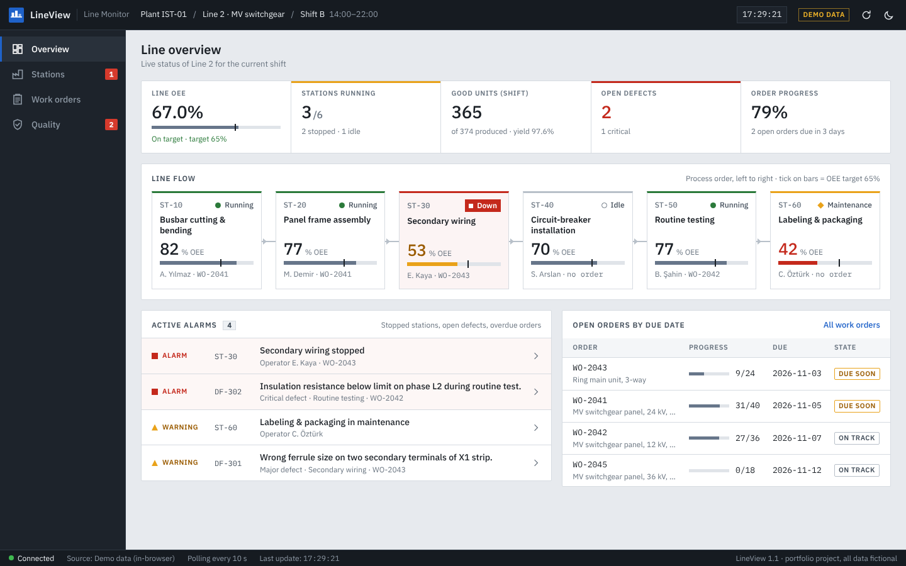
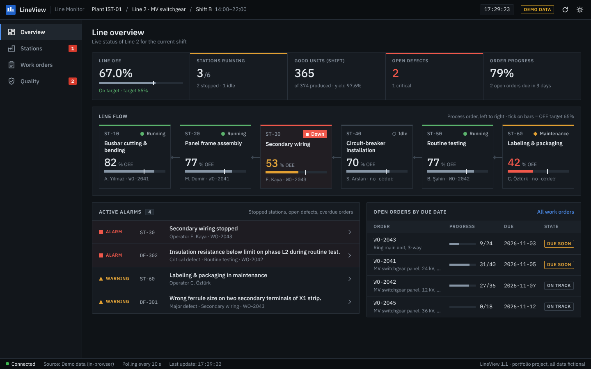
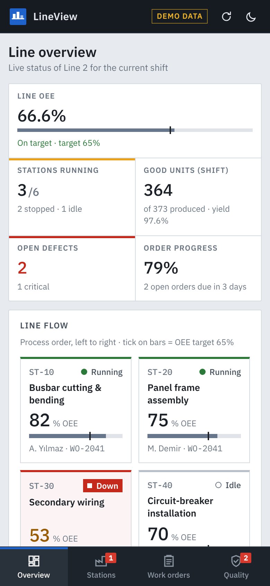

# LineView: production line monitor

An MES-style line monitor for a (fictional) medium-voltage switchgear assembly line: live station status and OEE, work-order progress, an alarm list, and a quality-defect log you can add to and close.

**Live demo:** https://yahyahelwa.github.io/LineView/ (runs on in-browser demo data)



<p>
  
  
</p>

## Why I built it

I'm a final-year Mechatronics Engineering student at Yıldız Technical University. In my workshop internship I wired control panels for a machinery manufacturer, and in my medical-device internship I documented how regulated teams track quality and CAPA. I wanted to build the kind of tool a factory digitalization team would ship: a screen that turns line data into something operators and engineers can act on.

## Features

- **Four views, like a real plant tool:** Overview, Stations, Work orders and Quality, switched from a nav rail. Views use hash URLs (`#/stations`), so links are shareable and the back button works without a router or server config.
- **Overview:** KPI strip (line OEE against a 65% target, stations running, good units and yield, open defects, order progress), a *line flow* diagram of the stations in process order, an alarm list, and open orders by due date.
- **Alarm list:** stopped stations, open defects and overdue orders, ranked by severity; each row links to the view where it can be handled.
- **Stations:** data grid with OEE split into availability, performance and quality, a target marker on each OEE bar, status filter with counts, and search by station, ID or operator.
- **Work orders:** sortable grid with station, priority, progress and a computed state (complete, overdue, due soon, on track).
- **Quality defects:** report a defect with client-side validation (POST), close it (PATCH), show/hide closed items.
- **HMI-style visuals (ISA-101 ideas):** grey for normal values and colour only for abnormal ones; every status has a shape as well as a colour (running ●, idle ○, maintenance ◆, down ■; alarm ■, warning ▲), so it still reads in greyscale or for colour-blind users. Dark app chrome, dense tables, IBM Plex type with monospaced IDs and numbers.
- **Header and status bar:** plant / line / shift breadcrumb with a live clock, plus a status bar showing the data source, connection state and last update.
- **Live refresh:** polls the API every 10 s, cancels in-flight requests with `AbortController`, keeps the last good data if a refresh fails and shows an error banner with retry.
- **Accessible and responsive:** semantic HTML, labelled form controls, `aria-live` status messages, focus moves to the page heading on view change, keyboard focus styles, skip link, `prefers-reduced-motion`, light/dark theme that follows the OS and is remembered. The nav rail collapses to icons on tablets and becomes a bottom tab bar on phones; tables turn into cards.

## Tech stack

React 19 · TypeScript · Vite · plain CSS (custom properties, grid, `color-mix`) · IBM Plex (self-hosted via Fontsource, so it works offline) · Vitest + Testing Library · json-server (mock REST API) · oxlint · GitHub Actions + GitHub Pages

## Run it locally

```bash
npm install
npm run dev          # demo mode: in-browser mock data, no backend needed
```

### With a real REST API

```bash
npm run api          # json-server on http://localhost:3001 (resets data from src/data/seed.json)
npm run dev:api      # in a second terminal: the app talks to the API (VITE_API_URL from .env.api)
```

Endpoints used: `GET /stations`, `GET /workOrders`, `GET /defects`, `POST /defects`, `PATCH /defects/:id`.

### Checks

```bash
npm test             # unit and component tests (Vitest)
npm run lint         # oxlint
npm run build        # type-check + production build
```

## How it is organised

```
src/
  api/client.ts        typed fetch wrapper: JSON, timeouts, ApiError with HTTP status
  api/lineApi.ts       LineApi interface + HTTP implementation + in-browser demo implementation
  hooks/usePolling.ts  fetch now, then every N ms; aborts on unmount
  hooks/useHashView.ts which view is open, read from the URL hash
  lib/metrics.ts       OEE, line summary, OEE target, order state (pure functions, unit-tested)
  lib/alarms.ts        builds the ranked alarm list from a snapshot (unit-tested)
  lib/shift.ts         three-shift calendar (A/B/C)
  lib/validation.ts    defect form validation
  components/          app shell: AppHeader, NavRail, StatusBar, Icon
                       overview: KpiCards, LineFlow, AlarmList, OrdersDue
                       views:    StationGrid, WorkOrderTable, DefectPanel
                       shared:   StatusBadge, Meter
  data/seed.json       sample data shared by the demo mode and json-server
```

The UI only depends on the `LineApi` interface, so switching from the demo to a real backend is one environment variable (`VITE_API_URL`). More detail in [docs/ARCHITECTURE.md](docs/ARCHITECTURE.md).

## How OEE is calculated

OEE = Availability × Performance × Quality

- Availability = run time ÷ planned time
- Performance = (ideal cycle time × units produced) ÷ run time
- Quality = good units ÷ units produced

Each factor is clamped to 0–100% so bad input never shows as NaN or 130%.

## How I used AI tools

I built this with an AI pair-programmer (Claude). I described the features and the data model, then reviewed every file, ran the tests and linter, and fixed what they caught (for example a test-cleanup bug and two React lint warnings about impure renders and state updates in effects). I can explain and change any part of the code.

## Ideas for next steps

- Charts of OEE over the shift (e.g. with a small SVG sparkline per station)
- Role-based views (operator vs. quality engineer)
- Real-time updates with Server-Sent Events instead of polling
- Port the UI to Siemens iX or Angular to compare frameworks

---

All data is made up. Not affiliated with any company.
